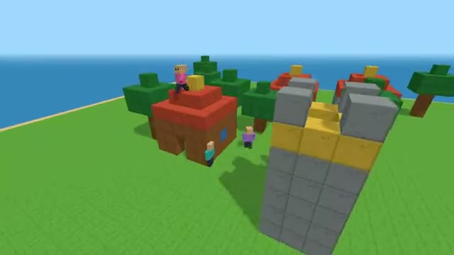

# Voxel Builders

Build a block world together. It remembers. A multiplayer starter game from [Multiplayer Agent](https://multiplayeragent.com): 3D, co-op, 1–16 players, with bots that build beside you.

## How it plays

Walk around a little island and place and break blocks in eight colors. Bots build trees and houses beside you, and the world is still there the next time you come back.

**Controls:** WASD and mouse, click to place, right-click to break, 1 to 8 for colors, or the on-screen stick and buttons.

## Make it yours in the Game Builder

Open the [Game Builder](https://multiplayeragent.com), choose **Start from a starter game** and pick Voxel Builders. It opens as version 1 in your studio, ready to play and publish. Then ask for changes, for example:

- Add a day and night cycle
- Add doors and glass blocks
- Add a creative mode where you can fly

## Run it yourself

1. Get a free publishable key (`pk_…`) at [multiplayeragent.com](https://multiplayeragent.com).
2. In `index.html`, put it in place of `pk_REPLACE_ME` in the `MP_CONNECT` block.
3. Serve the folder (for example `npx serve`) and open it. The 3D engine loads as a module, which browsers block from a file on disk.

Without a key it still runs, offline with bots, and remembers your world in this browser.

## How it is built

- One `index.html` plus three.js in `libs/`. The comment at the top of the script maps the code and explains the multiplayer.
- **World memory:** The world is remembered by the players who built it. Every player saves a copy every 10 seconds and when they leave; whoever comes back first brings it back for everyone, and a copy with more building in it replaces a newer, emptier one.
- **Host-run rules:** The host's browser checks every block placed or broken. If it leaves, the next player takes over.
- **Bots:** Bots wander the island and build trees, houses and towers until enough people join.
- **Live sync:** Every block and every builder shows up for everyone at once.
- `?attract` runs it offline with bots only. The preview video is recorded from it.

## License

MIT. three.js in `libs/` is MIT too (Copyright 2010-2024 three.js authors).
